# Hi 👋 I'm Kittitouch Thipmontha (Nonbangkok)

---

### 👨‍💻 About Me

I’m a Computer Engineering student at **Chulalongkorn University** with interests in **AI, machine learning, and competitive programming**.

I enjoy exploring intelligent systems, building software, and applying technology to solve problems. I’m also interested in astronomical technology and exploring agentic AI and its real-world applications.

---

### 💻 Tech Stack

**Languages**

**Web Development**

**Backend & Databases**

**AI & Data Science**

**DevOps & Infrastructure**

**Hardware & Embedded**

**Tools**

---

### 💼 Experience

• 👨‍🏫 Teaching Assistant — POSN Computer Olympiad Camp 1  
• 👨‍🏫 Teaching Assistant — POSN Computer Olympiad Camp 2 (Walailak University) 

---

### 🏆 Achievements

• 🥈 Silver Medal — Neo Science Olympiad 2025 : Mathematics  
• 🥈 Silver Medal — Thailand I-New Gen Award 2025  
• 🥈 1st Runner-up — Super AI Engineer Season 5 : Track Innovator  
• 🥉 2nd Runner-up — 21st Triam Udom Mathematics and Science Olympiad (TUMSO)  
• 🥉 Bronze Medal — 21th Thailand Olympiad in Informatics (TOI 21)  
• 🥉 Bronze Medal — SUT Astro Coding Challenge 1st  
• 🏆 The Best Innovation Award — Creative AI Camp 2024  
• 🚀 Qualified (Top 36 Teams) — Bangmod Hackathon 2023 & 2024  
• 🎖️ Honorable Mention — PSU Mathematics Competition (PMC) 2024  
• 💡 Founding Round — National Software Contest 2025 (NSC 2025)  
• 🤖 Participant — Southern Inventor Award 2025  
• 🤖 Participant — Thailand Olympiad in Informatics 20 (TOI 20)  
• 🤖 Participant — TPA Robo Rescue with MicroROS

---

### 🌐 Social Media

---

### 📊 GitHub Stats

---

### 🐍 Contribution Snake

<picture>
  <source media="(prefers-color-scheme: dark)" srcset="https://raw.githubusercontent.com/Nonbangkok/Nonbangkok/output/github-contribution-grid-snake-dark.svg">
  <source media="(prefers-color-scheme: light)" srcset="https://raw.githubusercontent.com/Nonbangkok/Nonbangkok/output/github-contribution-grid-snake.svg">
  
</picture>
